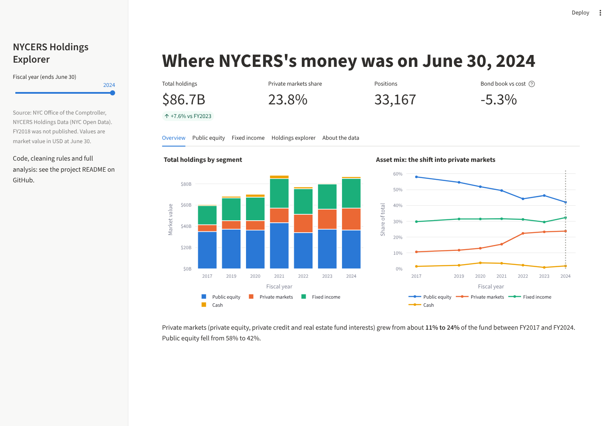
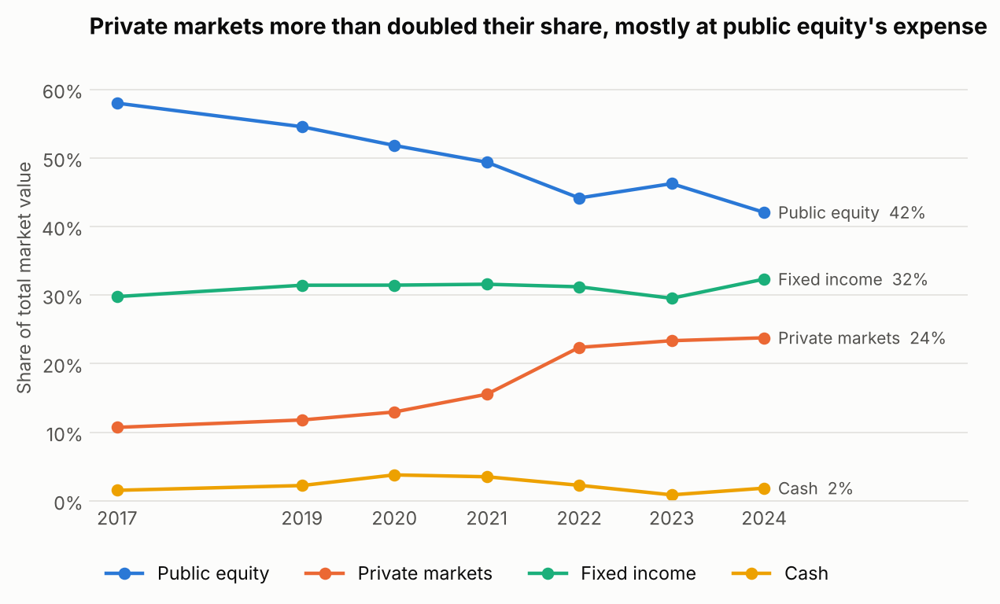
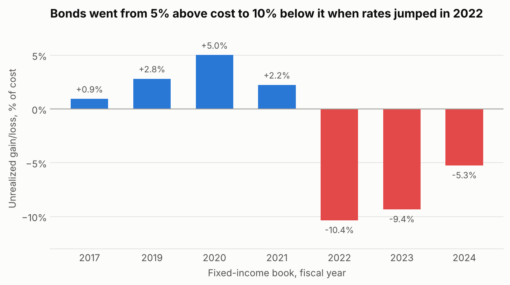
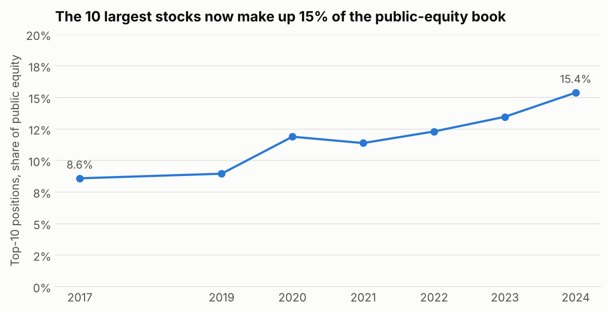
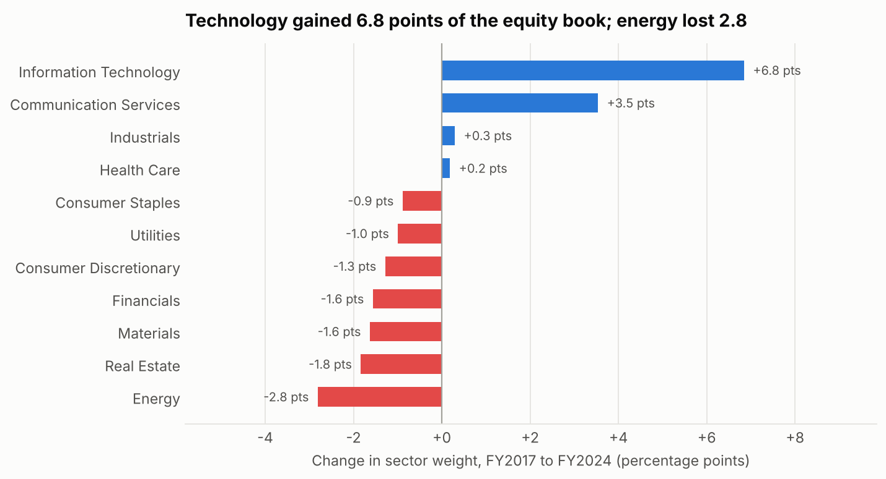
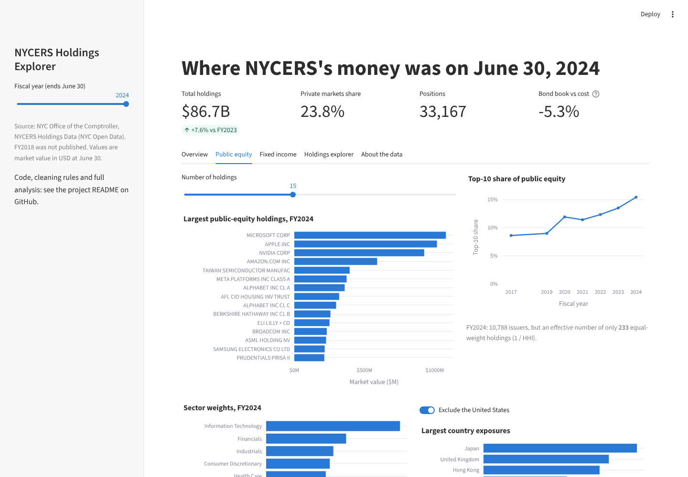
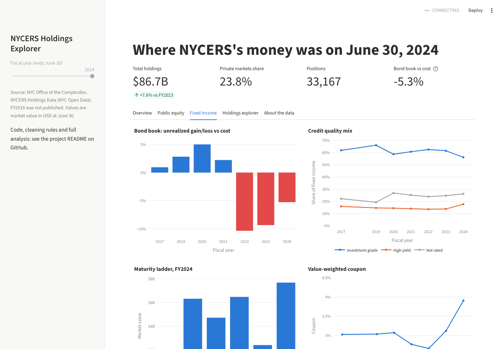

# Where does an $87B pension fund put its money?

[](https://nycers-dashboard.streamlit.app/)

**An analysis of New York City Employees' Retirement System (NYCERS) holdings, FY2017 to FY2024, with an interactive dashboard.**

NYCERS publishes every position it holds at each fiscal year-end (June 30): about 30,000 to 40,000 stocks, bonds, fund interests and cash lines per year. This project cleans seven of those snapshots into one tidy dataset, uses it to see how the fund's allocation and risk changed, and puts the results into a dashboard anyone can explore.

**[Live dashboard](https://nycers-dashboard.streamlit.app/)** · **[Analysis notebook](notebooks/nycers_analysis.ipynb)** · **[Cleaning pipeline](src/nycers/clean.py)**



---

## Key findings

| | Finding |
|---|---|
| 📈 | **Holdings grew 44%, from $60.4B to $86.7B.** FY2022 was the only down year (-12%). |
| 🔄 | **Private markets more than doubled their share, from 11% to 24%.** Public equity fell from 58% to 42%. |
| 🎯 | **The stock book got more concentrated.** The top 10 stocks went from 8.6% to 15.4% of public equity. Microsoft, Apple and Nvidia alone are about 8%. |
| 💻 | **Tech replaced energy.** IT rose from 18% to 25% of sector-classified stocks. Energy halved, from 5.7% to 2.9%. |
| 📉 | **The 2022 rate shock pushed bonds underwater.** The bond book went from +5.0% vs cost (FY2020) to -10.4% (FY2022), and was still -5.3% in FY2024. |
| 💵 | **New bonds pay more.** The value-weighted coupon rose from 2.66% (FY2022) to 3.91% (FY2024). |
| ⚠️ | **Credit risk crept up.** High-yield bonds rose from 13.6% to 17.7% of fixed income in FY2024. |

<p float="left">
  
  
</p>
<p float="left">
  
  
</p>

The full reasoning, with every chart and table, is in the [analysis notebook](notebooks/nycers_analysis.ipynb).

---

## The data, and what had to be fixed

**Source:** NYC Office of the Comptroller, *NYCERS Holdings Data*, on [NYC Open Data](https://opendata.cityofnewyork.us). Export dated 2025-10-08: 299,944 rows by 25 columns, with one snapshot per fiscal year for FY2017 and FY2019 to FY2024 (FY2018 isn't published).

About 1 in 5 raw rows shouldn't be analysed as-is. [`clean.py`](src/nycers/clean.py) applies these rules and writes a [log](data/processed/cleaning_log.json) of what each one removed:

| Issue | Rows | Treatment |
|---|---:|---|
| Placeholder rows dated `12/31/1899` with every field `0` | 48,350 | Dropped |
| Completely blank rows | 119 | Dropped |
| Exact duplicate rows | 7,113 | Dropped (about $7M total, <0.01% of assets) |
| A single position dated FY2015 | 1 | Dropped |
| `Groupt Trust` typo | 40,994 | Fixed |
| Two spellings of "United States" | | Merged |
| Ratings like `Ba1u`, `(P)B3`, `A-p`, `BAA3`, `- 0`, `WR` | | Normalised to standard S&P and Moody's scales. When both exist, the lower rating is used. |

**Result:** 244,361 clean positions in [`data/processed/holdings_clean.parquet`](data/processed/holdings_clean.parquet) (10 MB).

### Choices that matter

* **No outlier removal.** In a portfolio, the "outliers" are the biggest positions: US Treasuries ($9.3B), Microsoft, Apple. An IQR filter would delete the story.
* **No log transforms or scaling before aggregating.** Dollar amounts get summed, so they stay in dollars.
* **Each year is its own snapshot.** Pooling the years would count Apple seven times.
* **Unrealized gain is not called a "return".** The data has cost basis but no cash flows, so it can show how far positions sit above or below cost, not a time-weighted return.
* **Private markets are their own segment.** The source labels private equity, private credit and real estate LP interests as `VENTURE CAPITAL` inside equity. Mixing them with listed stocks would hide the biggest allocation change in the data.

---

## Dashboard

A Streamlit app with a fiscal-year slider and five tabs:

* **Overview:** total holdings, asset mix over time, KPI tiles
* **Public equity:** top holdings (adjustable N), concentration trend, sector weights, country exposure
* **Fixed income:** bond book vs cost, credit-quality mix, maturity ladder, coupon trend
* **Holdings explorer:** search and filter all positions for a year, then download as CSV
* **About the data:** sources, cleaning and caveats

<p float="left">
  
  
</p>

---

## Run it

```bash
git clone https://github.com/saisanthos/NYCERS.git && cd NYCERS
python -m venv .venv && source .venv/bin/activate
pip install -r requirements-dev.txt

streamlit run app/streamlit_app.py     # dashboard (uses the committed clean data)
pytest -q                              # tests
```

To rebuild everything from the raw CSV, download it as described in [`data/raw/README.md`](data/raw/README.md), then run `make data notebook`.

**Deploy for free:** push to GitHub, go to [share.streamlit.io](https://share.streamlit.io), choose this repo and set the main file to `app/streamlit_app.py`.

---

## Project structure

```
NYCERS/
├── app/streamlit_app.py          # interactive dashboard
├── data/
│   ├── raw/                      # raw CSV goes here (not committed, 57 MB)
│   └── processed/                # clean parquet + cleaning log (committed)
├── notebooks/nycers_analysis.ipynb
├── reports/
│   ├── figures/                  # charts exported by the notebook
│   └── screenshots/              # dashboard screenshots
├── src/nycers/
│   ├── clean.py                  # raw CSV -> tidy table, with logged rules
│   ├── metrics.py                # aggregations shared by notebook and app
│   └── style.py                  # one chart style and colour map
├── tests/test_clean.py
├── Makefile
└── requirements.txt
```

## Limitations

* Snapshots are yearly, so nothing here describes what happened between June 30s. FY2018 is missing.
* There are no cash flows, so there are no time-weighted returns. Unrealized gain/loss is measured against cost.
* Private-market values are lagged appraisals. Their share tends to jump when public markets fall (the "denominator effect", visible in FY2022).
* There's no CUSIP or ISIN in the data, so a company can show up under several names (for example Alphabet class A and class C).

## Tools

Python · pandas · NumPy · PyArrow · Matplotlib · Plotly · Streamlit · pytest

## Background

This started as a team project in my third semester. The first version stacked all years together, removed "outliers" and modelled a target derived from its own features. This rebuild treats the data as what it is, a series of portfolio snapshots, and focuses on findings that hold up.
